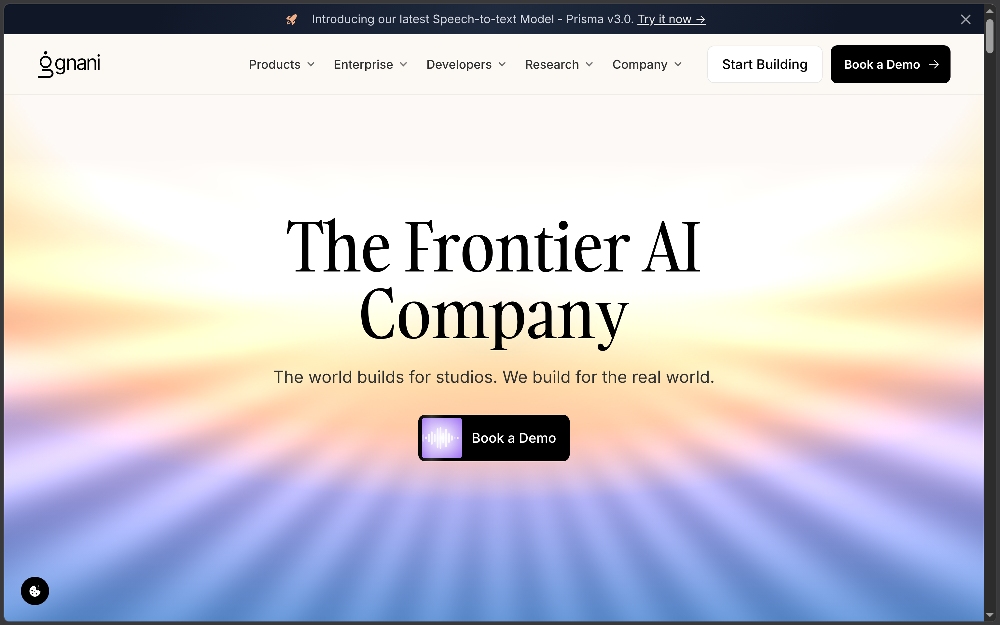

[](https://github.com/NousResearch/hermes-agent)

# Gnani AI Plugin for Hermes Agent



**Transcribe voice notes, dictate live, and hear spoken replies in Hermes Agent.** This independent community plugin registers `gnani` as both a speech-to-text and a text-to-speech provider. It uses Gnani Prisma to turn audio into text and Gnani Timbre to generate spoken audio.

[Install and configure](#install-and-select) · [Speech settings](#speech-settings) · [Privacy and troubleshooting](#privacy-and-troubleshooting)

| Capability | Models | Transports |
| --- | --- | --- |
| Speech-to-text | Prisma v3.0 and v2.5 | REST, realtime WebSocket, Batch |
| Text-to-speech | Timbre v2.5 and v3.0 | REST audio, SSE PCM |

## Install and select

Use Hermes Agent **0.23.2 or newer** with Python **3.14**. The reference host is v0.23.2. Install FFmpeg with `ffprobe` on PATH for duration checks on compressed recordings. PCM WAV can be measured without FFmpeg.

### Install from Git today

```sh
hermes plugins install ANAMASGARD/hermes-gnani/gnani --ref 19b1e2396c909656144ff6cab4b16dc2e14260dd --yes-deps --enable
hermes plugins doctor gnani --ci
```

### Install from the Hermes catalog

The shorter command becomes available once Hermes publishes the listing. [Track the catalog PR](https://github.com/NousResearch/hermes-agent/pull/157704)

```sh
hermes plugins install gnani
hermes plugins enable gnani
hermes plugins doctor gnani --ci
```

### Configure speech

Create a key in [Gnani's console](https://app.gnani.ai). Set `GNANI_API_KEY` as a secret in the **Gnani** plugin settings in Hermes Desktop, or add it to the active profile's Hermes-managed `.env` using a private editor. The plugin resolves it through the active Hermes secret scope on each operation. Start a new session if the host has cached the old credential.

Merge [examples/config.yaml](examples/config.yaml) into your active profile to select `gnani` for STT and TTS and enable live transcription, chained voice mode, and streamed replies. Hermes v0.23.2 requires YAML for STT selection. For TTS, you can also choose **Gnani AI / Timbre** in `hermes tools` or select `gnani` in the dashboard after discovery. Edit models, languages, and per-model voices in the Gnani plugin settings form or YAML. Core overrides in `stt.gnani` and `tts` take precedence. Clear an old `tts.voice` override when switching to a model with a different voice catalog.

### Install from a local checkout

Copy the `gnani` folder to the active Hermes profile's `plugins/gnani` directory and enable it. The default profile uses `~/.hermes`. Use an empty destination or a disposable profile when testing.

```sh
hermes plugins validate "$PWD/gnani" --install-deps
mkdir -p "${HERMES_HOME:-$HOME/.hermes}/plugins/gnani"
cp gnani/*.py gnani/plugin.yaml "${HERMES_HOME:-$HOME/.hermes}/plugins/gnani/"
hermes plugins enable gnani
hermes plugins list --enabled
hermes plugins doctor gnani --ci
```

## Speech settings

- **Prisma** defaults to v3.0 and `indic-auto`. A specific locale such as `hi-IN` or `en-IN`, or up to four comma-separated v3.0 locale hints, can guide recognition. Prisma v2.5 requires one supported locale. Both models offer `verbatim` and `transcribe`. Prisma v3.0 also offers `codemix` and `transliterate`. See the [supported languages and REST options](https://docs.gnani.ai/api/STT/speech-to-text.md).
- **Context** goes under `plugins.entries.gnani.settings`. v3.0 accepts `keyterms`, `topic`, `previous_text`, and `speaker_names`. v2.5 uses `bias_list` and `bias_score`. Live free-form context requires single-line ASCII because it travels in headers. REST supports Unicode free-form context.
- **File transcription** accepts WAV, MP3, OGG/Opus, FLAC, AAC, and M4A. Clips beyond 30 seconds and Batch-only MP4, WebM, and AMR inputs use Batch. Batch lacks transliteration, previous-text context, and v2.5 number formatting. If an active job exceeds the synchronous wait, the error includes its ID. For a presigned-upload HTTP 404, compress to FLAC or split the recording into files under 10 MB. Check [job status](https://docs.gnani.ai/api/STTBatch/Get_Job.md), [retrieve completed files](https://docs.gnani.ai/api/STTBatch/Get_Job_Files.md), or [cancel the job](https://docs.gnani.ai/api/STTBatch/Cancel_Job.md). Avoid submitting a duplicate while the original is running. Hermes can split uploads above its own size limit before invoking the plugin.
- **Live transcription** uses Gnani's final speech segments. Hermes may try the recording path after a failed or empty live result. Gnani caps sessions at 15 minutes and closes connections after a period without speech.
- **Timbre** defaults to v2.5 and `Nalini`. v3.0 defaults to `Shivani` and supports [expressive tags](https://docs.gnani.ai/api/TTS/tts-audio-tags.md). The [case-sensitive catalogs](https://docs.gnani.ai/api/TTS/available-voices.md) list 42 v2.5 voices and 34 v3.0 voices. Choose a locale, `hi-en` for Hinglish, or `auto` for detection by script. Speed is 0.85–1.15 on v2.5 and 0.8, 1.0, or 1.2 on v3.0. WAV, MP3, and OGG Opus are native. Opus uses the OGG container and unsupported file formats use a WAV fallback. Streamed playback uses 24 kHz mono PCM.

## Privacy and troubleshooting

Selected recordings, microphone PCM, transcription context, and text to speak go to `api.vachana.ai`. Gnani charges API calls to the active key subject to its account terms. Batch can also transfer an audio file and download a transcript through Gnani-issued signed links for its S3 bucket. The Gnani key goes only to the Vachana API. The plugin invokes the installed `ffprobe` with fixed arguments for local media inspection and writes audio to the path requested by Hermes or an ephemeral voice-delivery file. The plugin uses no telemetry.

- **401 or missing key** — check the active Hermes profile's `GNANI_API_KEY`.
- **403** — check the key's permissions and model or Batch entitlement.
- **429** — let active requests finish and check the limits for your Gnani account.
- **Invalid voice or language** — confirm that the exact voice belongs to the selected model and that v2.5 STT has one explicit locale.
- **File duration unavailable** — install `ffprobe` or export the recording as PCM WAV.
- **Provider missing** — run Plugin Doctor and confirm the correct profile, the plugin enablement state, and the Hermes version.

## Development

Use a separate checkout of [Hermes v0.23.2](https://github.com/NousResearch/hermes-agent/releases/tag/v0.23.2). Run `uv sync --locked --no-dev` in that checkout, then export its source and site-packages for the plugin tests.

```sh
export HERMES_SRC=/absolute/path/to/hermes-agent
export PYTHONPATH="$HERMES_SRC:$HERMES_SRC/.venv/lib/python3.14/site-packages"
uv sync --locked
uv lock --check
uv build
uv run ruff check gnani tests
uv run ruff format --check gnani tests
uv run mypy gnani
uv run python -m pytest -m 'not live' --disable-socket --allow-unix-socket --cov=gnani
```

CI builds the source archive and wheel and validates the plugin directory extracted from the wheel. Use `GNANI_TEST_HERMES=1` with a disposable `HERMES_HOME`, the copied and enabled plugin, and the example config with `tts.output_format: wav` to include the host discovery and dispatch test. The test uses the actual Hermes registries and dispatchers with controlled vendor responses.

For billable smoke tests, inject `GNANI_API_KEY` from your secret manager and opt in explicitly. The tests run serially. Both model pairs are exercised through Hermes when the installed-host tests are enabled. The optional `GNANI_LIVE_AUDIO_EN`, `GNANI_LIVE_AUDIO_HI`, `GNANI_LIVE_AUDIO_MIXED`, and `GNANI_LIVE_AUDIO_LONG` variables point to local recordings authorized for upload.
Set `GNANI_LIVE_PRESIGNED=1` separately to test the documented upload route above 10 MB. This route returned HTTP 404 during release testing.

```sh
GNANI_RUN_LIVE_TESTS=1 GNANI_LIVE_OUTPUT="$PWD/.live/gnani-api" uv run python -m pytest -m live
```

Reproduce actual microphone playback in Hermes chained voice mode with both providers selected and streaming enabled. Use the [research notes](docs/research/gnani-hermes.md) when changing protocols or adding a new model. Validate any new model against official docs and a real account before advertising it.

Licensed under [MIT](LICENSE). The Hermes provider interfaces belong to Nous Research. The speech services and published catalogs belong to Gnani AI. [Hermes Sarvam](https://github.com/Subramanyarao11/hermes-sarvam) served as a registration and packaging reference.
